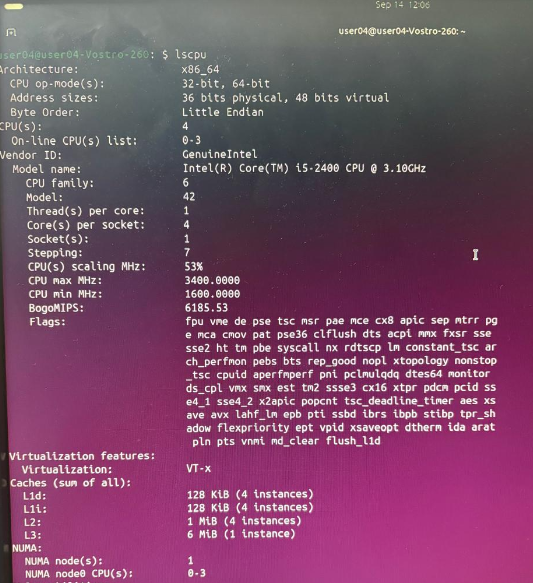
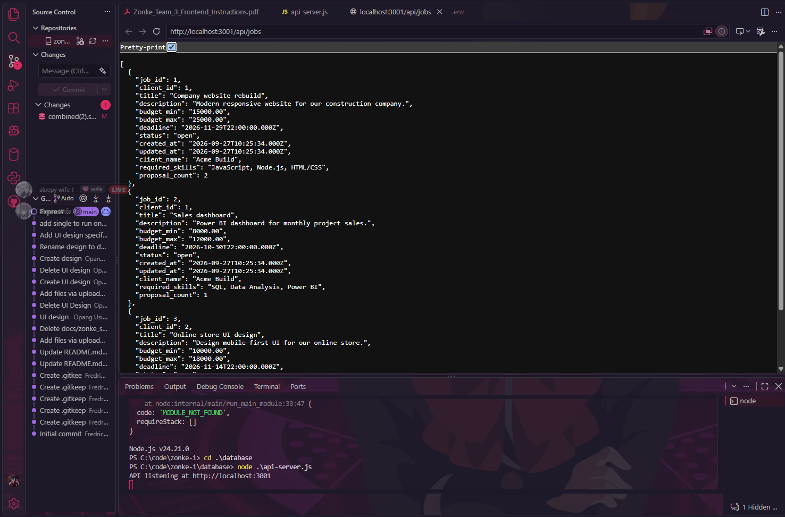
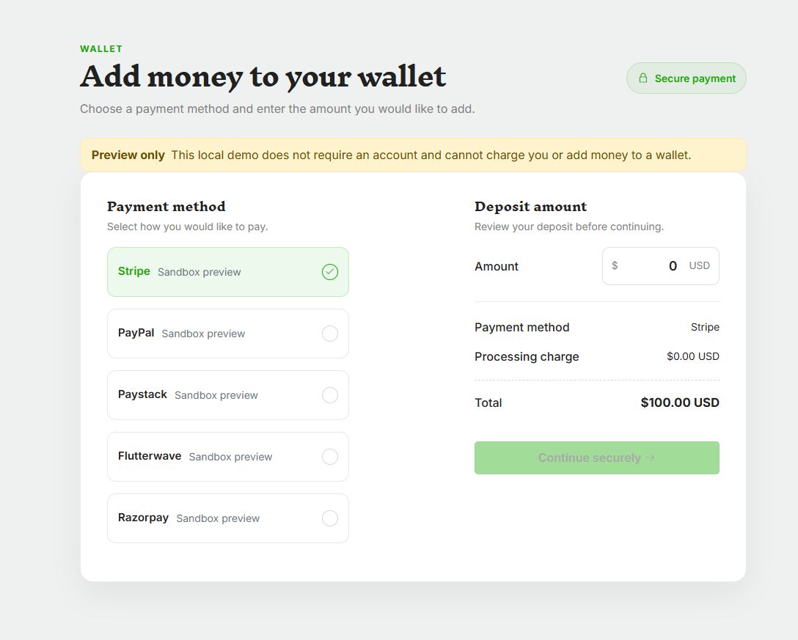

# Kyle Khoza | Work Integrated Learning Portfolio

**Information Technology WIL Student · Tobb Technologies · 2026**

> A record of practical software development, database integration, IT investigation and business-support work completed during my Work Integrated Learning placement.

## About me

I am a Bachelor of Science in Information Technology student at Richfield Graduate Institute of Technology. During my WIL placement at Tobb Technologies, I worked across web development, database integration, application improvements and technical investigation. I applied classroom concepts to practical tasks, documented my work and used screenshots, repository history and a demonstration recording as supporting evidence.

## Portfolio overview

| Item | Details |
|---|---|
| Student | Kyle Khoza |
| Programme | BSc Information Technology — Richfield Graduate Institute of Technology |
| Placement | Tobb Technologies |
| Workplace supervisor | Fredrick Kato |
| Documented placement period | 11 September 2026 – 30 October 2026 |
| Daily log entries | 18 dated entries in the supplied logbook |
| Main project areas | Zonke website, PHP website features, payment UI, IT investigation, business growth strategy |
| Technologies evidenced | MySQL, SQL, Node.js, Express, npm, PHP, Laravel research, Ubuntu/Linux, GitHub |

## Featured evidence

The following images are selected from the evidence supplied with this portfolio. Open the [assets folder](assets/) to view the complete set.

| IT investigation | Database development | Application interface |
|---|---|---|
|  |  |  |

Additional evidence: [CV upload interface](assets/2026-10-19-cv-upload-validation-140912.png) · [backend development](assets/2026-10-16-zonke-backend-development-075206.png) · [GitHub evidence screenshots](assets/).

## Portfolio index

| Section | What it contains |
|---|---|
| [Daily-Log](Daily-Log/) | Dated work records based on the WIL logbook, with available proof linked by date |
| [Zonke Contribution](Projects/Zonke-Contribution/) | Database, backend integration and security work |
| [PHP Website Features](Projects/PHP-Website-Features/) | CV upload and validation work |
| [Payment System UI](Projects/Payment-System-UI/) | Payment interface refinements and testing evidence |
| [IT Infrastructure Investigation](Projects/IT-Infrastructure-Investigation/) | Hardware, operating system, network and security investigation |
| [Business Growth Marketing](Projects/Business-Growth-Marketing/) | Digital marketing and business growth strategy work |
| [Documentation](Documentation/) | Supplied WIL logbook and supporting documentation |
| [Final Report](Final-Report/) | Summary of placement activities, learning and outcomes |

## Projects and contributions

### 1. Zonke website — database and backend contribution
Planned and developed a MySQL database prototype, configured Node.js dependencies, connected an Express API to MySQL, supported frontend integration and worked on password salting, API rate limiting and Helmet security headers.

- Repository: [FredrickKcode/zonke](https://github.com/FredrickKcode/zonke)
- My author-filtered commit history: [Shi-ki-is-gone commits](https://github.com/FredrickKcode/zonke/commits?author=Shi-ki-is-gone)
- Source diffs for each of the seven matching commits: [Zonke contribution source links](Projects/Zonke-Contribution/README.md#source-code-and-contribution-history)
- Logbook commit reference: [database branch commit history](https://github.com/FredrickKcode/zonke/commits/main/database)

### 2. PHP website — CV upload functionality
Worked on CV document upload, file handling, upload validation, file type and size restrictions, and user-facing error messages. Researched PHP and Laravel before implementing the feature.

### 3. Payment system — interface improvements
Updated the payment interface styling, improved visual consistency between the amount and currency sections, and took part in testing the implemented functionality.

- Demonstration: [View the recorded feature demonstration](https://youtu.be/X6wuuTl0p3I)

### 4. IT infrastructure investigation
Investigated computer hardware and software performance using command-line diagnostics, physical hardware inspection and system/network tests. Documented findings relating to RAM and network performance.

### 5. Business growth marketing strategy
Prepared a digital marketing approach intended to increase awareness, visits to Tobb Technologies' online channels, relevant enquiries and opportunities for new client relationships.

## Key achievements

- Produced a documented computer hardware, software and network investigation supported by screenshots.
- Built a MySQL database prototype and connected it to an Express/Node.js backend.
- Contributed backend security improvements including password salting, API rate limiting and Helmet security headers.
- Implemented CV upload validation, including file type and file size checks.
- Improved the payment interface and participated in functional testing, with a recorded demonstration.

## Technical skills

| Area | Tools / technologies used or explored |
|---|---|
| Database | MySQL, SQL, MySQL Workbench |
| Backend | Node.js, Express, npm |
| Web development | PHP, Laravel (research and preparation), frontend/backend integration |
| Security | Password salting, API rate limiting, Helmet security headers, upload validation |
| Operating systems and diagnostics | Ubuntu, Linux command line, hardware inspection, system and network testing |
| Collaboration and documentation | GitHub, Markdown, screenshots, technical documentation |

## Daily work record

The daily log combines all dated entries from the supplied WIL logbook in one README, with available evidence linked under each date.

See [Daily-Log](Daily-Log/).

## Placement learning

This placement strengthened my ability to move from theoretical concepts to practical implementation. I gained experience with database design and integration, backend development, application security, file handling, system diagnostics and technical documentation. It also developed my communication, planning, collaboration and problem-solving skills through work involving colleagues and existing systems.

## Contact
- **Email:** Kjcooljj@gmail.com

---
